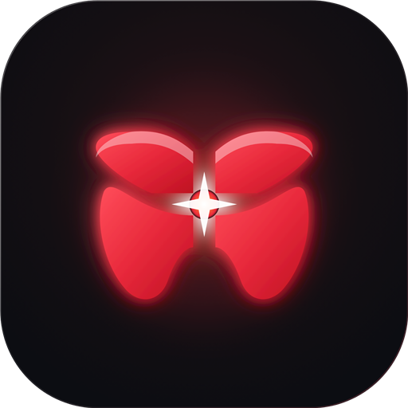
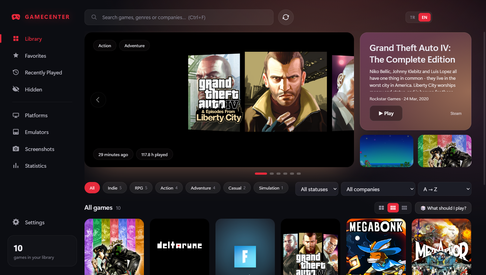
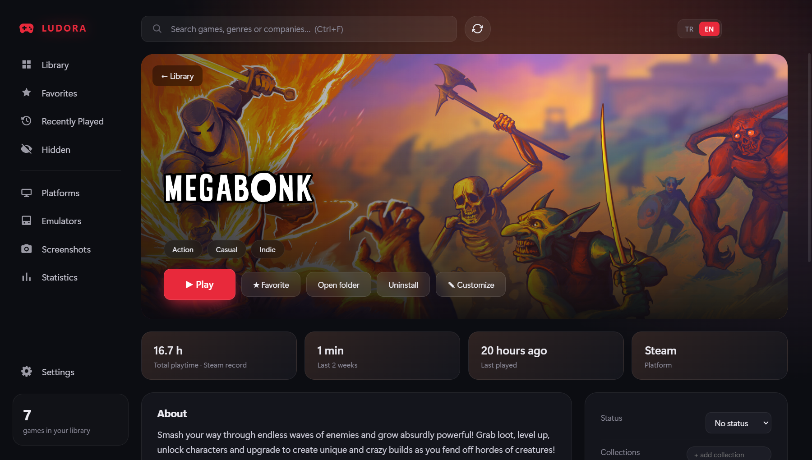
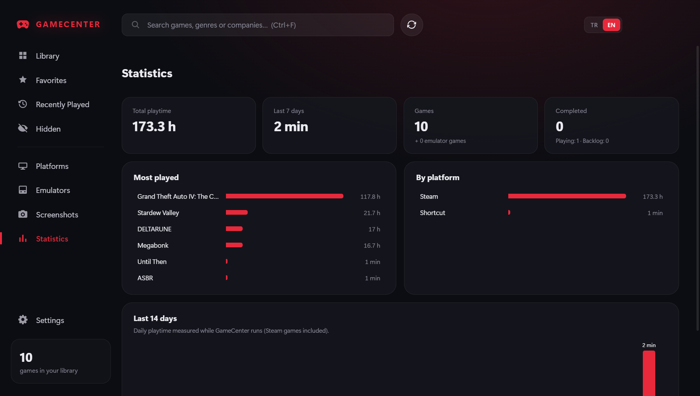

<h1 align="center">
  <br>
  GameCenter
</h1>

<p align="center">
  <b>All your PC games in one place.</b><br>
  A Windows game launcher that finds the games you already have on Steam, Epic Games, Xbox / Game Pass, EA app, Ubisoft Connect, GOG and your emulators, and shows them in one good-looking library.
</p>

<p align="center">
  <a href="https://github.com/yigittozdemirr/game-center/releases/latest"><b>⬇ Download for Windows</b></a>
  &nbsp;·&nbsp; English / Türkçe
  &nbsp;·&nbsp; Free and open source (MIT)
</p>



## Features

**One library, every launcher**
- Finds installed games automatically: Steam, Epic Games, Xbox / Game Pass, EA app, Ubisoft Connect, GOG.
- Optional extra folders for games without a launcher, and an **Emulators** tab (PCSX2, DuckStation, Dolphin, PPSSPP, RPCS3, Cemu, Ryujinx, mGBA, melonDS, RetroArch and more) that lists your ROMs as games.
- Games launch through their own platform, exactly as before. Games you install or remove while GameCenter is open appear or disappear on their own.

**Rich game pages**
- Banner, cover, logo, description, genres, developer, publisher and release date, pulled from the Steam store, from Wikipedia for games that aren't on Steam, and from the libretro archive for emulator games. No API keys needed.
- The background glows in the colors of each game's artwork.
- Official Steam news and patch notes for the game.
- Wrong match? Use **Search Steam** to pick the right game, or set your own banner, cover and logo.

**Playtime that actually means something**
- Steam playtime is read from Steam itself. Xbox playtime comes from Xbox Live when you connect your account.
- Everything else is measured while GameCenter runs.
- "● Playing" shows while a game is running, and the same game can't be launched twice by accident.
- A **Statistics** page shows total hours, most played games, playtime per platform and the last 14 days.

**Organize your way**
- Filter by genre, company, status (Playing / Completed / Backlog / Dropped) and your own collections.
- Favorites, recently played and hidden games.
- 4, 6 or 8 games per row.
- **What should I play?** picks a random game when you can't decide.

**Built for playing**
- **Screenshots** with a hotkey (F10 by default, rebindable) and a soft shutter sound. Screenshots are sorted into one folder per game and can be browsed, copied and deleted inside the app.
- Lives in the **system tray**: double-click to open, right-click to launch recent games. Optionally minimizes when a game starts and starts with Windows.
- **Uninstall** opens the right uninstaller: Steam, Xbox, EA, GOG or the game's own.
- **Custom launch path** per game, for example a mod loader.
- English and Turkish UI, and a theme color you choose.

| Game page | Statistics |
|---|---|
|  |  |

## Install

1. Download `GameCenter-Setup-x.y.z.exe` from [Releases](https://github.com/yigittozdemirr/game-center/releases/latest).
2. Run it. Windows may show a blue **"Windows protected your PC"** screen because the installer isn't code-signed yet: click **More info → Run anyway**.
3. GameCenter finds your games on first launch. Nothing to configure.

Requires Windows 10 or 11 (64-bit). The installer opens in English, or in Turkish on Turkish Windows.

## Uninstall

GameCenter uninstalls like any other Windows app:
- **Settings → Apps → Installed apps → GameCenter → ⋯ → Uninstall**, or
- **Control Panel → Uninstall a program → GameCenter**, or
- run `Uninstall GameCenter.exe` in the install folder (by default `%LOCALAPPDATA%\Programs\GameCenter`).

This removes the app and its shortcuts. Your library, settings (`%APPDATA%\gamecenter`) and screenshots (`Pictures\GameCenter`) are kept, so reinstalling picks up where you left off. Delete those folders yourself to remove everything.

## Platforms

| Platform | How it works |
|---|---|
| Steam | Read from Steam's own files. Playtime and your account name come straight from Steam, with no sign-in needed. |
| Epic Games | Read from Epic's install manifests. Epic offers no official way for other apps to read playtime, so GameCenter measures it. |
| Xbox / Game Pass | Read from Windows' app packages. Connect your Microsoft account on the **Platforms** page for real Xbox playtime (optional). |
| EA app, Ubisoft Connect, GOG | Read from Windows' registry. GameCenter measures playtime. |
| Emulators | Add the emulator's exe and your ROM folder on the **Emulators** page. |

<details>
<summary><b>Connecting an Xbox account (optional)</b></summary>

Xbox sign-in uses Microsoft's official login, which requires a (free) app ID from Azure. You only need to set this up once:

1. Personal Microsoft accounts can't register apps on their own anymore. If Azure says *"creating applications outside of a directory has been deprecated"*, first create a free account at <https://azure.microsoft.com/free/>. It asks for a phone and card for identity verification; nothing is charged unless you upgrade to a paid plan yourself.
2. Go to <https://portal.azure.com> → **App registrations** → **New registration**. Name it `GameCenter` and choose **Personal Microsoft accounts only**.
3. Under **Redirect URI**, pick **Public client/native (mobile & desktop)** and enter `https://login.microsoftonline.com/common/oauth2/nativeclient`.
4. Copy the **Application (client) ID**, paste it into the Xbox card in GameCenter and click **Connect**.

The ID isn't a secret: anyone can use the same ID to sign in to their own account. The refresh token is stored encrypted with Windows' user encryption (DPAPI) and deleted when you disconnect.
</details>

## Privacy

GameCenter runs entirely on your PC. There's no account, no telemetry and no server of its own.

To show game info and artwork, it sends the **names of your installed games** (and Steam app IDs) to:
- the Steam store (`store.steampowered.com`, `api.steampowered.com`, `steamstatic.com`),
- Wikipedia / Wikidata (for games that aren't on Steam),
- the libretro thumbnail archive (`thumbnails.libretro.com`, emulator covers only).

No other information about you or your PC is sent. You can switch this off any time in **Settings → General → Download game info and artwork from the internet**. When it's off, GameCenter sends nothing on its own and shows games with their local icons. The installer shows this notice before installing.

Microsoft / Xbox Live is contacted only if you connect an Xbox account yourself. The sign-in token is stored encrypted on your PC and deleted when you disconnect.

Your library, settings and screenshots stay in `%APPDATA%\gamecenter` and your Pictures folder.

## Build from source

```bash
git clone https://github.com/yigittozdemirr/game-center.git
cd game-center
npm install
npm start          # run in development
npm test           # run the tests
npm run dist       # build dist/GameCenter-Setup-<version>.exe locally
```

Releases are built by GitHub Actions: bump `version` in `package.json`, then push a matching tag (e.g. `git tag v1.1.0 && git push origin v1.1.0`).

Built with [Electron](https://www.electronjs.org/), plain HTML/CSS/JS, no frameworks.

### A note on antivirus false positives

The installer ships Electron's original, unmodified executable renamed to `GameCenter.exe` (`signAndEditExecutable: false`, `asar: false` in `package.json`). When the build tool embedded the icon and version info into the exe, the file became "never seen before" and some antivirus products (e.g. Kaspersky) flagged it by behavior. Keeping the well-known original binary avoids that. Shortcuts and the Programs list get their icon from `resources/icon.ico`.

Because of this, Task Manager lists the process as "Electron".

## Code signing

Windows installers are built from this repository's source by [GitHub Actions](.github/workflows/release.yml) on GitHub-hosted runners and published on the [Releases](https://github.com/yigittozdemirr/game-center/releases) page.

Releases are **not code-signed**, so Windows may show **"Windows protected your PC"** the first time you run the installer. Click **More info → Run anyway**. The release workflow can sign installers later without other changes; see [docs/SIGNING.md](docs/SIGNING.md).

## License

[MIT](LICENSE) © 2026 yigittozdemirr
